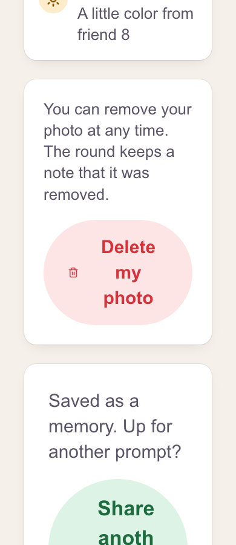
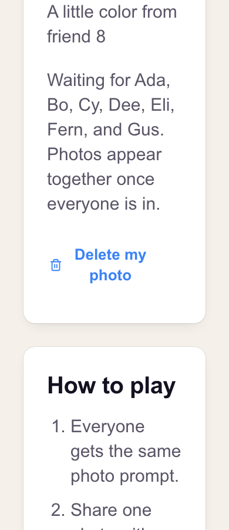
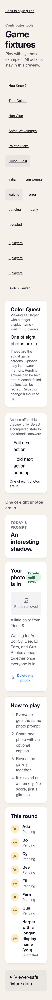

# Screenshots color-quest-text-reflow

Captured 2026-11-06T20:53:56.557Z from the working tree based on commit eca4ede (including the Color Quest text-reflow fix) at 390px CSS width (1x) unless labelled otherwise. layout-* captures include 820px tablet, 1280px desktop, and 200% text; production desktop captures use 1440px. Full-page captures draw the fixed tab bar mid-page, use the -viewport files for exact framing.

Reviewed waiting/revealed states at 390px with 200% Arial text. The focused browser journey also checks document/button overflow and keyboard deletion cancellation/focus return.

- 
- 
- 
- 

4 files, 1.0 MB.
